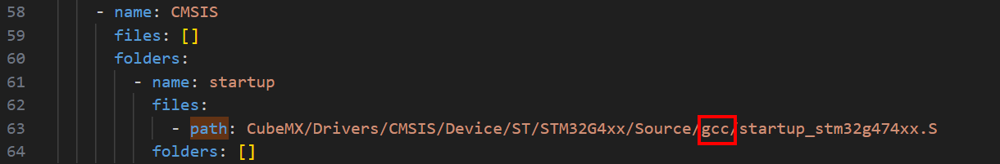
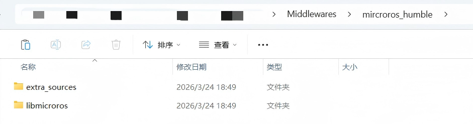
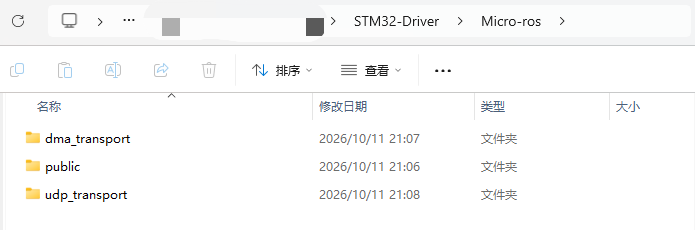

# 嵌入战队模板

## 启动文件修改

注意如图eide.yml中startup文件的path中的标注位置，一定要改成`gcc`！！

## 添加文件

在模板的 `Middlewares` 层新建文件夹，用于存放 `microros` 相关文件。

这里命名为 `microros_humble` 。

向文件夹中添加如图所示文件，随后在工程中添加以下文件即可：

* `libmicroros.a`

* `custom_memory_manager.c`

* `microros_allocators.c`

* `microros_time.c`

* `dma_transport.c`：如果你不是用串口+DMA通信，改用符合的文件。

把 `extra_sources` 中的文件全部整合成到同一级。

## 文件修改

上述文件对战队模板有许多不适配之处，故读者可去仓库自取符合战队模板的驱动代码。

## 串口配置

+ 记得开启所需串口, `DMA RX` , `DMA TX` 全开。 
+ `DMA` 接收缓冲区改成1024。

## 堆栈配置

打开 `FreeRTOSConfig` 文件，将 `configTOTAL_HEAP_SIZE` 改为 **1024*40** 。

## 构建配置

+ `GCC` 编译器用 **`13.2.rel1`** 版本（已验证可用，其他更高版本读者可自行测试）！
+ 链接脚本路径就是 `STM32F429XX_FLASH.ld` 的路径，如果你放根目录下，直接写 `STM32F429XX_FLASH.ld` 即可。
+ 链接库选项改为 `-lm -lmicroros` 。

## 接下来编译通过即可。