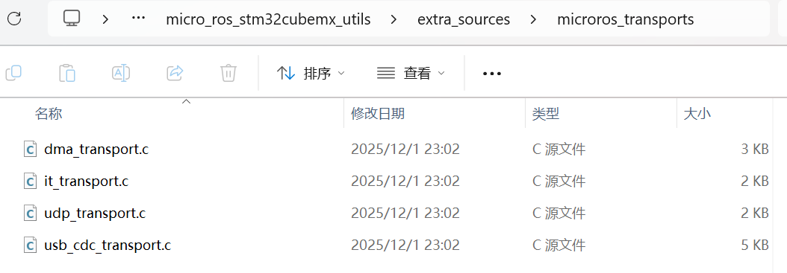
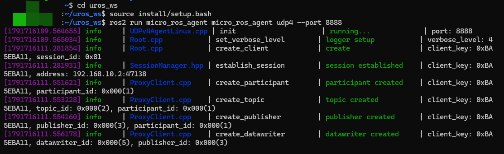
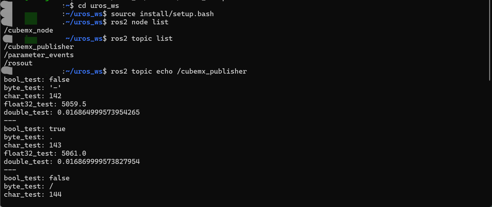

# 网口传输

## 协议介绍



回到我们编译静态库的那个文件夹，找到上图所示的位置，这里有着 `micro-ROS` 传输消息的四种方式：

+ `dma_transport.c:` 串口 + DMA
+ `it_transport.c:` 串口 + 中断
+ `udp_transport.c:` 以太网/Wi-Fi + UDP协议
+ `usb_cdc_transport.c:` 原生USB虚拟串口

**传输速率：** 网口 >> 虚拟串口 >> 串口

由此可见，原先使用的 **串口 + DMA** 模式只适合做个小测试，新手入门使用，在真正的工程中遇到稍微大一些的数据量，就极易堵塞造成程序卡死。网口的优势是基于网络协议栈，通过以太网接口发送UDP数据报，笔者这里用的**W5500模块**做的测试。

---

## 依赖

以下驱动在仓库自取：

+ `udp_transport.c`
+ `udp_transport.h`
+ ………

相关头文件添加至 `MicroROSConfig.h`

## 例程

以下使用自定义消息做测试：

```
bool bool_test
byte byte_test
char char_test
float32 float32_test
float64 double_test
```

测试代码如下：

```c
static w5500_udp_transport_args_t microros_udp_args = {
    .agent_ip = {192, 168, 10, 1},
    .agent_port = 8888U,
    .local_port = 8888U,
    .socket_num = 0U
};

static const W5500_NetworkConfig microros_network = {
    .mac = {0x02, 0x08, 0xDC, 0x55, 0x00, 0x01},
    .ip = {192, 168, 10, 2},
    .subnet = {255, 255, 255, 0},
    .gateway = {192, 168, 10, 1}
};

void TestTask(void *argument) {
    /* USER CODE BEGIN 5 */
    UNUSED(argument);
    uint8_t version;
    uint8_t link_up;

    W5500_TestStatus = W5500_Init(&microros_network);
    if (W5500_TestStatus == W5500_OK) {
        W5500_TestStatus = W5500_GetVersion(&version);
        if (W5500_TestStatus == W5500_OK) W5500_TestVersion = version;
    }
    if (W5500_TestStatus == W5500_OK) {
        W5500_TestStatus = W5500_GetLinkStatus(&link_up);
        if (W5500_TestStatus == W5500_OK) W5500_TestLink = link_up;
    }
    if (W5500_TestStatus != W5500_OK) {
        printf("W5500 init failed: %d\n", (int)W5500_TestStatus);
        vTaskSuspend(NULL);
    }

    rmw_ret_t transport_res = rmw_uros_set_custom_transport(
        false, &microros_udp_args, w5500_udp_transport_open,
        w5500_udp_transport_close, w5500_udp_transport_write,
        w5500_udp_transport_read);
    if (transport_res != RMW_RET_OK) {
        printf("micro-ROS UDP transport setup failed: %ld\n",
               (long)transport_res);
        vTaskSuspend(NULL);
    }

    // 配置 FreeRTOS 动态内存分配器
    rcl_allocator_t freeRTOS_allocator =
        rcutils_get_zero_initialized_allocator();
    freeRTOS_allocator.allocate = microros_allocate;
    freeRTOS_allocator.deallocate = microros_deallocate;
    freeRTOS_allocator.reallocate = microros_reallocate;
    freeRTOS_allocator.zero_allocate = microros_zero_allocate;

    if (!rcutils_set_default_allocator(&freeRTOS_allocator)) {
        printf("Error on default allocators (line %d)\n", __LINE__);
    }

    // 3. 定义 micro-ROS 基础实体与变量
    rcl_publisher_t publisher;
    my_custom_message__msg__MyCustomMessage msg;
    rclc_support_t support;
    rcl_allocator_t allocator = rcl_get_default_allocator();
    rcl_node_t node;
    rcl_ret_t res;

    // 4. 初始化 init_options 并显式设置固定的 client_key
    rcl_init_options_t init_options = rcl_get_zero_initialized_init_options();
    rcl_init_options_init(&init_options, allocator);

    rmw_init_options_t *rmw_options =
        rcl_init_options_get_rmw_init_options(&init_options);
    rmw_uros_options_set_client_key(
        0xBA5EBA11, rmw_options); 

    // 5. 使用带配置选项的接口初始化 support
    res = rclc_support_init_with_options(&support, 0, NULL, &init_options,
                                         &allocator);
    if (res != RCL_RET_OK) {
        printf("rclc_support_init failed: %d\n", res);
        vTaskDelay(portMAX_DELAY); 
    }

    // 6. 创建节点
    res = rclc_node_init_default(&node, "cubemx_node", "", &support);
    if (res != RCL_RET_OK) {
        printf("rclc_node_init_default failed: %d\n", res);
        vTaskDelay(portMAX_DELAY);
    }

    // 7. 创建发布者
    res = rclc_publisher_init_default(
        &publisher, &node,
        ROSIDL_GET_MSG_TYPE_SUPPORT(my_custom_message, msg, MyCustomMessage),
        "cubemx_publisher");
    if (res != RCL_RET_OK) {
        printf("rclc_publisher_init failed: %d\n", res);
        vTaskDelay(portMAX_DELAY);
    }

    // 8. 填充测试消息初始值
    msg.bool_test = true;
    msg.float32_test = 0;
    msg.byte_test = 0;
    msg.double_test = 0;
    msg.char_test = 'a';

    // 9. 主工作循环
    while (1) {
        rcl_ret_t ret = rcl_publish(&publisher, &msg, NULL);
        if (ret != RCL_RET_OK) {
            printf("Error publishing (line %d)\n", __LINE__);
        }

        msg.bool_test = !msg.bool_test;
        msg.byte_test++;
        msg.double_test += 0.000005f;
        msg.char_test++;
        msg.float32_test += 1.5f;

        vTaskDelay(pdMS_TO_TICKS(100));
    }
    /* USER CODE END 5 */
}
```

**`microros_udp_args`：告诉 micro-ROS 怎么通过 UDP 找 Agent**

- `agent_ip = {192, 168, 10, 1}`：micro-ROS Agent 的 IP 地址。
- `agent_port = 8888U`：Agent 接收数据的 UDP 端口。
- `local_port = 8888U`：设备本地使用的 UDP 端口。
- `socket_num = 0U`：使用 W5500 的 0 号硬件 Socket。

**`microros_network`：配置 W5500 本身的网络身份**

- `mac`：W5500 的 MAC 地址，注意要唯一，不要与其他设备重复。
- `ip = {192, 168, 10, 2}`：设备自己的 IP。
- `subnet = {255, 255, 255, 0}`：子网掩码，表示设备和 `192.168.10.x` 的主机处于同一子网。
- `gateway = {192, 168, 10, 1}`：默认网关；这里也正好是 Agent 的地址。

这里的通信关系：设备 `192.168.10.2:8888` 通过 W5500 的 0 号 Socket，与 Agent `192.168.10.1:8888` 通信。

---

## 网络配置

这里以**win11**系统为例

+ 快捷键 `Win + R`
+ 输入 `ncpa.cpl`
+ 找到连接网口对应的以太网，点击属性（笔者这里是用 `usb` 转网口）
+ 找到 `Internet 协议版本 4(TCP/IPv4)`
+ 填入IP地址和子网掩码，需与上述例程中对应


+ 配置完成后，可以在 `powershell` 中运行 `ipconfig` 检查配置是否成功。

## 代理端构建

开一个wsl终端，执行以下命令：

```
cd uros_ws												     //切换至工作目录下
source install/setup.bash								     //加载相应资源
ros2 run micro_ros_agent micro_ros_agent udp4 --port 8888    //构建agent
```



再新建一个wsl终端，执行以下命令：

```
cd ~/uros_ws                         //切换至工作目录下
source install/local_setup.bash      //加载相应资源
ros2 daemon stop                     //停止 ROS 2 的后台守护进程
ros2 daemon start                    //开启 ROS 2 的后台守护进程
                                     //这两步是重启 Ros 2 的网络发现机制
ros2 node list                       //查询节点
ros2 topic list                      //查询话题
ros2 topic echo /cubemx_publisher    //运行话题
```

注：`ros2 daemon stop` 和 `ros2 daemon start` 大多数情况用不着，但有时候进程没关闭会影响我们agent的连接，视情况执行这两个命令。



---

## 恭喜成功！！